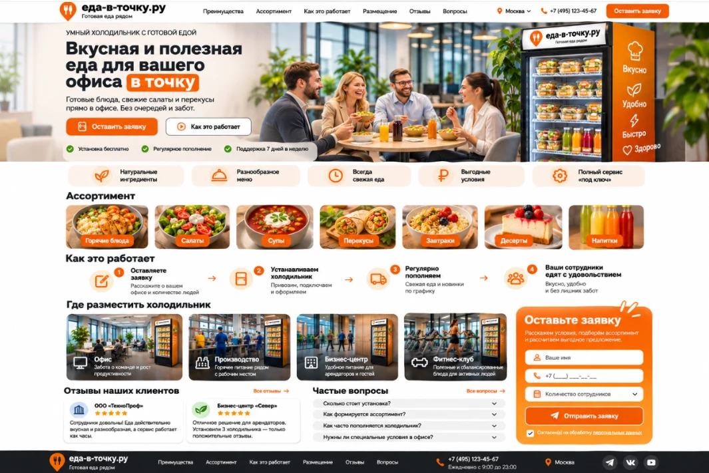

# Стиль v4 — «оранжево-белый, фотореализм»

Заменяет стиль v3 (2.5D-иллюстрации с героями Анна/Олег/Мария/Игорь, зелёная палитра). Пример для ссылок: `design/reference/style-reference.webp`.

## Что берём из референса
- Палитра: оранжевый (основной акцент `#f97316`, тёмнее `#ea580c`, светлый фон плашек `#fff1e6`) на белом, тёмно-графитовый текст `#1f2937`. Зелёный `#16a34a` — только мелкие галочки.
- Реалистичные фотоизображения еды и холодильника вместо мультяшных персонажей: светлый современный офис, дневной свет, живые люди.
- Компактная структура: hero → строка преимуществ (5 плашек с иконками) → ассортимент (7 фото-плиток) → «Как это работает» в одну строку → «Где разместить» (4 фото) → вопросы → заявка.
- Форма заявки справа: в hero рядом с текстом и/или закреплённая оранжевая карточка; на телефоне — под hero. Кнопка оранжевая, заметная.
- Чёткая иерархия: крупный H1 с оранжевой подсветкой ключевых слов, один главный CTA, второй — «ghost».
- Лендинговый формат сохраняем: одна страница с якорями, без многостраничности.

## Чего из референса НЕ берём
- Логотип, название, телефон, «Москва», соцсети, вымышленные отзывы клиентов (ООО «ТехноПроф» и т. п.) — это макет. На сайте: «Еда в точку», Тольятти, без личных контактов, отзывов не выдумываем (блок появится, когда будут реальные).
- Текст и надписи внутри картинок: на фото не должно быть букв, цифр, логотипов, вывесок, брендов ReFresh/REFRESHTECH. Экран и корпус холодильника — без надписей (оранжевая полоса и иконки допустимы, текст нет).

## Задачи на отрисовку (изображения, WebP ≤ 250 КБ, генерировать нейросетью по одной, без текста)
Единая база промпта: *photorealistic commercial photography, bright modern office, soft daylight, warm orange accent colors (#f97316), clean white and light-gray surroundings, shallow depth of field, appetizing fresh food, natural diverse office people, tall dark smart refrigerator with glass door, warm LED shelves and a vertical orange side panel with plain icons only. No text, no letters, no digits, no logos, no watermark, no signage.*

| # | Файл | Размер | Сцена |
|---|------|--------|-------|
| 1 | `hero.webp` | 1200×1500 (4:5) | Коллеги за общим столом обедают салатами и смеются; справа полностью видимый умный холодильник с оранжевой боковой панелью |
| 2 | `fridge-open.webp` | 1200×900 | Крупный план холодильника: 5 разных полок (салаты, горячее и супы, сэндвичи и роллы, выпечка и десерты, напитки), каждый продукт узнаваем |
| 3 | `food-hot.webp` | 800×600 | Горячее: курица с гарниром в контейнере, пар |
| 4 | `food-salads.webp` | 800×600 | Свежий салат в миске |
| 5 | `food-soups.webp` | 800×600 | Томатный суп/борщ со сметаной |
| 6 | `food-snacks.webp` | 800×600 | Роллы и сэндвичи |
| 7 | `food-breakfast.webp` | 800×600 | Каша/завтрак с ягодами |
| 8 | `food-desserts.webp` | 800×600 | Десерт с ягодами |
| 9 | `food-drinks.webp` | 800×600 | Холодные соки и напитки в бутылках |
| 10 | `place-office.webp` | 1200×900 | Холодильник в светлом open-space офисе |
| 11 | `place-production.webp` | 1200×900 | Холодильник в цехе/на производстве, сотрудники в спецодежде |
| 12 | `place-business-center.webp` | 1200×900 | Холодильник в холле бизнес-центра |
| 13 | `place-clinic.webp` | 1200×900 | Холодильник в коридоре медицинского/образовательного учреждения |
| 14 | `before.webp` | 1200×900 | Сотрудник в очереди в кафе смотрит на часы |
| 15 | `after.webp` | 1200×900 | Тот же сотрудник берёт еду из холодильника в офисе |
| 16 | `lead-relax.webp` | 1200×800 | Сотрудница расслабленно с обедом у холодильника (фон блока заявки) |

Иконки (преимущества, шаги) — простые контурные SVG-иконки внутри `index.html`, а не картинки в `images/` (проверка `image-audit` запрещает SVG-файлы в `images/`).

## Задачи на вёрстку
1. Переписать палитру в `landing.css` (оранжевый/белый), кнопки, плашки, фокус.
2. Новая структура `index.html` по референсу; сохранить обязательные элементы CI: `<h1>`, `landing.css`, без телефона/email и `app/`, `noindex`.
3. Hero с формой справа, адаптив 1440/768/390 px, высота страницы на телефоне ≤ 6500 px.
4. Обновить `tools/convert_illustrations.py` (`SPECS`) и `.github/workflows/image-audit.yml` (`expected`) под новый список файлов и размеры.
5. Удалить старые картинки v2/v3 и `before-after.webp`, обновить `docs/HANDOFF.md`.
6. Проверить: CI, скриншоты 1440 и 390, деплой копирует `images/` (уже есть в `deploy.yml`).
